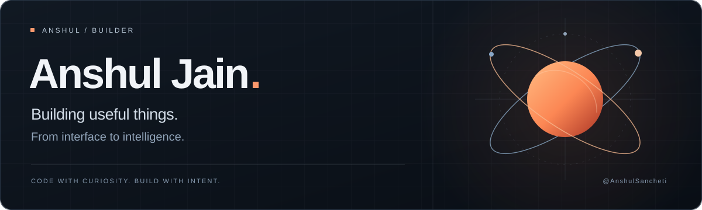

  

  <strong>Full-stack development · Computer vision · Product thinking</strong>

  <a href="#selected-work">Selected work</a> &nbsp; / &nbsp;
  <a href="#my-toolbox">My toolbox</a> &nbsp; / &nbsp;
  <a href="https://github.com/AnshulSancheti?tab=repositories">All repositories ↗</a>

---

### Hey, I'm Anshul.

I build software around practical problems: making home-exercise sessions easier to review, organising product data, and exploring rooftop solar potential through satellite imagery.

My work spans **interfaces, APIs, data, and computer vision**. I like understanding how the pieces fit together—and making the result useful to the person using it.

### Selected work

<table>
<tr>
<td width="50%" valign="top">

#### 01 / [Livia ↗](https://github.com/AnshulSancheti/Livia)

**Making home rehabilitation visible.**

A physiotherapist-configured exercise companion prototype. Uses pose landmarks and explicit movement rules to count repetitions and track session signals for clinician review.

Python · MediaPipe · Computer vision

</td>
<td width="50%" valign="top">

#### 02 / [Luminac ↗](https://github.com/AnshulSancheti/Luminac)

**Connecting a catalogue to a digital experience.**

A lighting website and product-data workspace covering catalogue organisation, structured data, import tooling, and web infrastructure.

Next.js · TypeScript · Cloudflare · Supabase

</td>
</tr>
<tr>
<td width="50%" valign="top">

#### 03 / [RoofIntel ↗](https://github.com/AnshulSancheti/RoofIntel)

**From satellite imagery to solar pre-assessment.**

A geospatial pipeline for building segmentation, roof-footprint extraction, and configurable solar estimates, with visual overlays and exportable results.

Python · PyTorch · Streamlit · Geospatial data

</td>
<td width="50%" valign="top">

#### 04 / [ShopKart ↗](https://github.com/AnshulSancheti/ShopKart)

**Following a purchase through the full stack.**

A MERN learning project with authentication, catalogue search, persistent carts and wishlists, order history, and Razorpay Test Mode checkout.

React · Express · MongoDB · Node.js

</td>
</tr>
</table>

### My toolbox

| Area | Technologies I use |
| :--- | :--- |
| Languages | Python · JavaScript · TypeScript · Java |
| Web | React · Next.js · Node.js · Express |
| Data & infrastructure | MongoDB · Supabase · Cloudflare · Git |
| Vision & experiments | MediaPipe · PyTorch · Streamlit |

### What interests me

- **Useful computer vision:** turning images and movement into understandable signals.
- **Complete product flows:** connecting the interface, backend, data, and deployment.
- **Learning by implementation:** building small tools to understand what happens underneath.

For a smaller systems experiment, take a look at my [shell built in Java ↗](https://github.com/AnshulSancheti/shell).

---

  <strong>Curiosity → experiments → useful software.</strong> 
  <a href="https://github.com/AnshulSancheti?tab=repositories">Explore what I'm building ↗</a>

